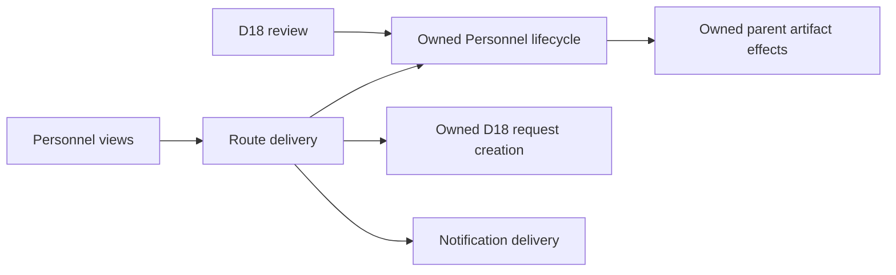

# D12 manual Personnel lifecycle ownership

This intermediate #1360 slice moves manual single/bulk archive, restore, permanent removal and the governance-approved Personnel effect into Personnel, including their parent-owned artifact cascade. All replaced central command callers move with them; the old Personnel command/factory and parent-only effects are removed without compatibility exports.

Delivery composes batch results, approval submission and the awaited permanent-removal notification. Web callers receive a narrow archive-approval callback while retaining lazy dialogs and acknowledged-result/draft recovery. The necessary adjacent D18 request-creation operation physically moves into its owner; both API POST and bulk Delivery consume its public server entry. Audit exposes its unchanged pure metadata helpers through its existing server entry. D18 review/list/cancel ownership remains later debt; this does not activate or complete #1366.

No migration, new permission grant, transaction/concurrency guarantee or remote database operation accompanies this change. Scheduled Personnel retention, merge/read/detail/bootstrap/export, separate artifact APIs and wider Web/switching/whole-issue acceptance remain open. #1360 acceptance is unchanged and the issue must remain open.

## Candidate and applicable baseline

Base: `c17fecbb4faedda5231c0b88d8fc99bf7daeffbb`. Frozen native/source candidate: `b8be9a586ef25c6d4436e49bb132061dfda663c5`; digest `696032575b34d8c8eec149905c4727874408d35b57ef8cb3c0a194f292207b0a`.

Reuse applicable accepted [bulk recovery proof](d12-lifecycle-recovery.md) from #1450 and [Edit recovery proof](d12-edit-archive-recovery.md) from #1453. Independent source comparison established that the relevant baseline application/caller blobs were unchanged through this base. Those original archives, tested revisions/digests and limitations remain intact. The unchanged production baseline at test-only `1def9f5e66ff9e6a07d1a48be844be7f2bf04bf8` passes 35 tests, including fresh-read delete → audit → awaited notification ordering, held completion and rejection.

The exclusive server worker's cutover is `9d4a76ce3a5c0cb8a37691beadbf158450ea9cac`, with 138 focused tests passing after its fixture-alias correction. Root integrated acceptance covers the actual combined candidate: **20 files / 195 tests pass**, **zero type errors/warnings**, focused formatting/ESLint/document links/diff checks pass, and canonical governance passes with **694 findings versus 708 on the base**. Existing reported debt remains open; no guard or exception changed. The only edit after the passing integrated test run was an erased creation-auth type adding the consumed Organization ID; final type/format/lint checks followed.

Exact commands, nonsecret unreachable offline provider overrides, source patch/hashes, tool versions and original failed outputs are packaged below. Preserved failed attempts include the worker fixture alias, discarded eager Web exports/private imports, retained-review metadata import, new private approval/Audit edges and a bare type run missing offline environment plus the consumed auth field. Corrected checks supersede those named failures without hiding them.

## Native observations

The owned production run used worker 2, Chromium 152.0.7977.82, origin `http://127.0.0.1:40043`, session `571d13c1-d739-4f8f-9013-c87923124c78`. Node 24.21.0/npm 11.19.0, Supabase CLI 2.101.0 and Docker 29.7.2 were recorded; the npm version differs from the repository's pinned 11.12.1 and its installation warnings remain preserved. Launcher ownership, distinct-port allocation and disabled legacy seed loading were inspected before launch. No existing local or remote data was used. There is no new SQL boundary or isolated SQL-suite claim.

- Roster and detail direct archive: simulated 503 leaves exact rows unchanged; visible retry returns 200, saved absence persists after reload, and owner Settings restore retains identity/history.
- Edit approval: actual Personnel 202 followed by submission 503 keeps the unsaved Duty Role and editable dialog; retry 201 closes it without saving that draft. A repeated 202/409 leaves one pending request. Owner review 503 retains pending identity and Person; retry 200 approves that same request and archives that same Person. Restore leaves the independently August-archived duplicate untouched.
- Edit direct archive: 503 retains the editable draft. A real 200 held after persistence leaves Save/Cancel/Archive disabled and Escape blocked. Release closes the editor without writing the unrelated draft.
- Visible bulk archive stores two parents under one event timestamp. Ordinary authorized API replay, including a duplicate ID, acknowledges those same IDs with no new effects. Operate-only archived replay creates no approval/effect. Foreign/missing, Alpha-to-Bravo/unassigned and empty-scope probes return per-ID errors with unchanged rows. These API probes are separate security/replay evidence.
- The ordinary operate actor still receives visible detail 403. Uncached detail approval-result handling remains focused lower-level coverage; no normally unreachable live approval journey is claimed.
- Training-only and Critical-Tasks-only active views omit the dedicated archived Person and include it after restore. Their stored completion facts remain literally unchanged.
- Typed permanent removal rejects the wrong name; Cancel preserves every target field. A 503 keeps the typed confirmation; retry 200 leaves the target absent after reload and a second provider read.

The native archive contains **54 literal whole-table no-effect comparisons**, **160 every-row archive/history/restore comparisons** and **32 additional observation comparisons**. Active artifact `updated_at` trigger metadata is checked separately as monotonic; independent August history, completed follow-up, Training/ICT, control and foreign rows compare literally. Every other retained identity/business field is checked. Documents contain metadata only and no Storage bytes.

Final helper cleanup preserved exact original A3/B1. Final doctor matched the original revision/digest and passed; owned cleanup passed. Controls were disarmed with no held responses. One approved request existed before teardown and no pending request; this is not a claim that every request row was removed before disposal.

The initial Edit Archive click only opened confirmation; its empty network output was before submission. One raw network-list read used an insufficient output budget and failed parsing despite a valid capture; corrected reads preserve the original output. Reload reset an observation hook, so actual 202/409 statuses are established by the retained native network list rather than the disarmed control. No source or driving instructions changed during the run.

Partial persistence/restore faults, approval effect-before-status ordering and awaited notification rejection remain meaningful lower-level proof, distinct from pre-request 503 and held-response UI evidence. There is no added atomicity, concurrency, real-file or remote-parity claim.

## Packaged proof

All packages were added **after final doctor and owned cleanup**. At that checkpoint, Definition of Done and updated verification/stabilization packaging instructions were reread; freshly fetched main remained the base above. Archive addition changes the checkout fingerprint without changing the tested application or pretending to be another live run. No historical proof was removed or rewritten. Credential-pattern inspection found no token material; no redaction was required.

| Run                                                                                                        | Archive SHA-256                                                    | Payload files / expanded bytes |
| ---------------------------------------------------------------------------------------------------------- | ------------------------------------------------------------------ | ------------------------------ |
| [Unchanged server baseline](d12-manual-lifecycle-proof/server-baseline.tar.gz)                             | `adbd0dab2b6642866536b66d6fec8a68e338b9cc0fec54867a3b147e73e1fae7` | 4 / 9,907                      |
| [Web checks and original attempts](d12-manual-lifecycle-proof/web-checks.tar.gz)                           | `2cbf1de74231fed9e2e9567009802c2c5493ee2868783ae80084ee3e53b108c3` | 15 / 13,231                    |
| [Exclusive server-owner checks](d12-manual-lifecycle-proof/server-owner-checks.tar.gz)                     | `807911f8be676816c55b4d5fbafbf4e3b2b55a61d19a17fa586558a4539bfd9c` | 54 / 232,930                   |
| [Root integrated checks and original attempts](d12-manual-lifecycle-proof/server-integrated-checks.tar.gz) | `be3ec5ea8d71025f0860cce75398efb0669e41490f56d0246473920181fed909` | 34 / 259,960                   |
| [Native final observations](d12-manual-lifecycle-proof/native-final.tar.gz)                                | `2f57b04c81426d5c6e706c049fd41088a914f76634542163a8a2690f9ada4bc5` | 437 / 3,130,370                |

Each archive contains `ARTIFACT_SHA256SUMS`, listing every sanitized payload's original relative filename and SHA-256 of expanded bytes, excluding only that inventory. The worker's original `SHA256SUMS` remains an unchanged payload. Root re-extracted every package into fresh ignored scratch and verified the exact payload file set and every hash.

Extract each archive into its own fresh ignored directory with `tar -xzf ARCHIVE -C DIRECTORY`, then run `sha256sum --check ARTIFACT_SHA256SUMS` there. Also compare the recursively expanded regular-file set, excluding only `ARTIFACT_SHA256SUMS`, with the inventory's filenames; checksums alone cannot detect extra files. The archive hash protects the inventory itself.

A later [test-only review follow-up](d12-manual-lifecycle-proof/review-followup.tar.gz), SHA-256 `9b6aae42b4afc12fe059a663fb728074afb69b59c354adaa63fee0b89da5db68`, contains 11 payloads / 8,276 expanded bytes; fresh expanded file-set/hash verification passes. It removes the unused `vi` binding exposed by CI from the moved creation tests. All eight creation tests and focused lint/format pass; no executable application, fixture, control or driving instruction changes. Existing native proof remains applicable at its original revision/digest. The follow-up also preserves the completed original CLI source review and its exact scope.

## Acceptance and release gates

Independent read-only review at the frozen source candidate reports **Standards PASS / scoped Spec source and coverage-selection PASS**, with no consequential source finding. Separate independent expanded-artifact acceptance also reports **Standards PASS / scoped Spec/source-and-artifact acceptance PASS**, after fresh extraction of the five verification archives, all 544 payload set/hash checks, recomputed raw comparisons, native actions/statuses and all nine screenshots. No consequential finding. This is not independent live execution or model diversity.

Before initial review/publication, the complete diff against `c17fecbb` at packaged head `f2848db3f69f78f400c613aeb8a04fdce30cbe3c` counted 53 canonical files / 54 with rename removal/addition separate, including all five verification archives. CodeRabbit CLI 0.8.2 completed all 48 supported text files with zero findings and exit 0; the five unsupported binary archives were independently accepted above. The test-only follow-up adds one archive; total final scope is 54 canonical files / 55 counting rename removal/addition separately, with six archives. Completed review of unchanged material is retained; the final host review covers the follow-up. Complete exact-candidate Depot CI/build and completed applicable bot review without actionable feedback remain merge gates; final host observations belong in the PR record. This intermediate PR uses `Refs #1360`.

CI performs no deployment or remote database operation. Vercel is separate, this branch is not disabled by repository configuration, and unknown external settings may deploy on publication/merge. This slice changes internal ownership while retaining product/data interfaces; no destructive schema release or manual database operation is added.
